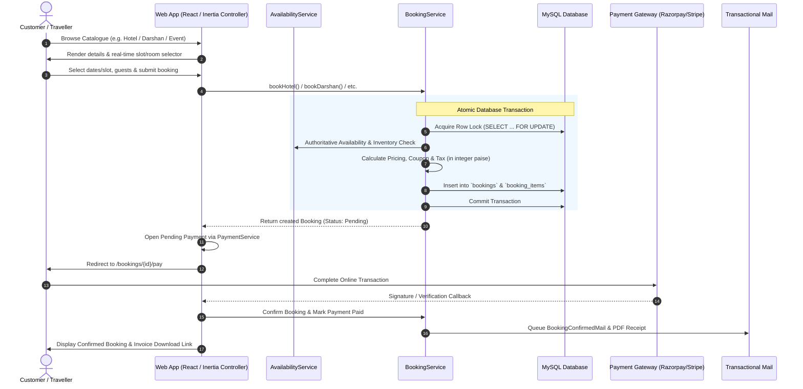
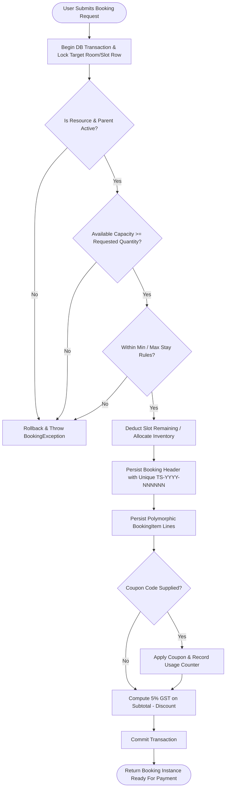
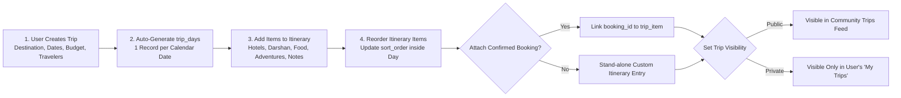
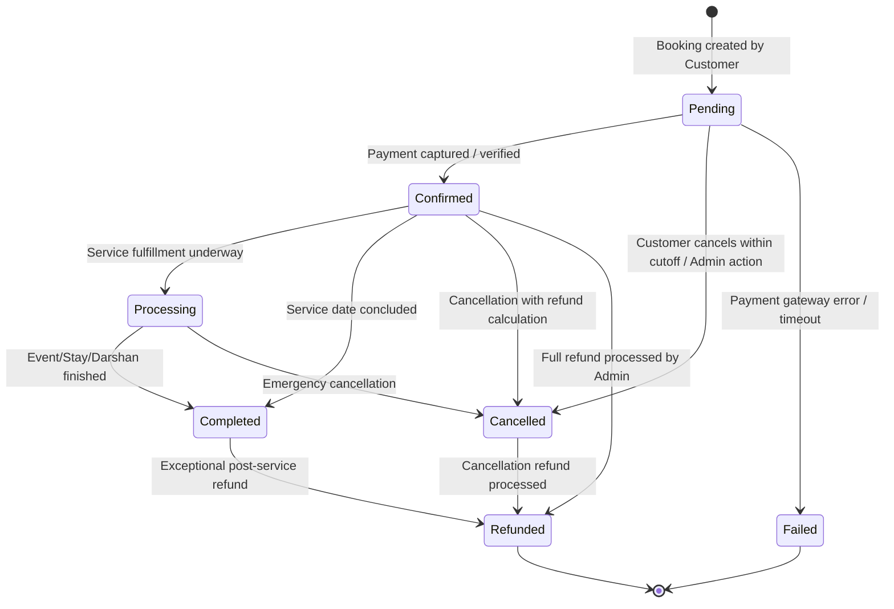

# Trip Sathi — Comprehensive System Documentation & Architecture Guide

> **Tagline:** *Plan Your Journey. Create Beautiful Memories.*  
> **Platform Version:** 1.0.0 (Production Architecture)  
> **Framework:** Laravel 11.x (PHP 8.2+)  
> **Architecture Pattern:** Laravel MVC + Service Layer + Strict Polymorphic Domain Modeling  

---

## Table of Contents

1. [Executive Summary & Core Concept](#1-executive-summary--core-concept)
2. [Technology Stack & System Dependencies](#2-technology-stack--system-dependencies)
3. [Repository Directory & Structural Blueprint](#3-repository-directory--structural-blueprint)
4. [Domain Model & Catalogue Architecture](#4-domain-model--catalogue-architecture)
5. [End-to-End User & Business Flows](#5-end-to-end-user--business-flows)
   - [5.1 User Journey: Discovery to Confirmed Booking](#51-user-journey-discovery-to-confirmed-booking)
   - [5.2 Concurrency-Safe Inventory & Availability Flow](#52-concurrency-safe-inventory--availability-flow)
   - [5.3 Multi-Gateway Payment & Capture Lifecycle](#53-multi-gateway-payment--capture-lifecycle)
   - [5.4 Interactive Trip Planning & Day-by-Day Itinerary Flow](#54-interactive-trip-planning--day-by-day-itinerary-flow)
   - [5.5 Booking State Machine & Transition Rules](#55-booking-state-machine--transition-rules)
   - [5.6 Admin Governance & Operations Flow](#56-admin-governance--operations-flow)
6. [Detailed Feature Specifications](#6-detailed-feature-specifications)
   - [6.1 Authentication, Authorization & Roles](#61-authentication-authorization--roles)
   - [6.2 Catalogue Discovery Engine (7 Vertical Streams)](#62-catalogue-discovery-engine-7-vertical-streams)
   - [6.3 Unified Booking Engine](#63-unified-booking-engine)
   - [6.4 Payment Gateways & Refund Management](#64-payment-gateways--refund-management)
   - [6.5 Trip Planner & Itinerary Builder](#65-trip-planner--itinerary-builder)
   - [6.6 Customer Account Portal & Self-Service](#66-customer-account-portal--self-service)
   - [6.7 Back Office / Admin Control Suite](#67-back-office--admin-control-suite)
   - [6.8 Social Proof: Verified Reviews & Testimonials](#68-social-proof-verified-reviews--testimonials)
   - [6.9 Communications, Inquiries & Newsletter](#69-communications-inquiries--newsletter)
7. [Database Schema & Entity Relationship Diagram (ERD)](#7-database-schema--entity-relationship-diagram-erd)
8. [Security, Performance & Concurrency Invariants](#8-security-performance--concurrency-invariants)
9. [API Architecture](#9-api-architecture)
10. [Local Development, Seeding & Deployment](#10-local-development-seeding--deployment)

---

## 1. Executive Summary & Core Concept

**Trip Sathi** is an enterprise-grade, all-in-one travel planning and booking ecosystem designed for the modern traveller in India. Unlike fragmented single-purpose booking sites, Trip Sathi bridges accommodation, event ticketing, outdoor adventures, local culinary experiences, and specialised **spiritual tourism** (VIP Darshan and Pooja Vidhi bookings) into a unified shopping cart and itinerary planner.

### Core Value Pillars

- **Unified Multi-Vertical Catalogue**: Travellers can book hotel rooms, register for temple darshan slots, reserve pooja rituals, book festival tickets, and schedule adventure treks within the same trip.
- **Race-Condition-Resistant Inventory**: Slot availability is backed by database row-level locking (`SELECT ... FOR UPDATE`) inside atomic transactions, guaranteeing zero double-bookings.
- **Exact-Precision Financials**: All monetary computations operate on integer minor units (paise for `INR`), completely eliminating floating-point rounding drift.
- **Multi-Day Itinerary Organizer**: Trips link individual bookings and custom activities into an interactive day-by-day itinerary with budget tracking.
- **Strictly Verified Social Proof**: Reviews can only be submitted by verified travellers who completed a booking for that specific item.
- **Full Operational Back Office**: An admin dashboard featuring real-time revenue KPIs, full catalogue CRUD, finite-state booking management, payment logs, and support inboxes.

---

## 2. Technology Stack & System Dependencies

| Layer | Technology | Version | Purpose & Implementation Details |
| :--- | :--- | :--- | :--- |
| **Backend Core** | PHP | `8.2+` | Strict typing (`declare(strict_types=1)`), constructor property promotion, enums |
| **Framework** | Laravel | `11.31+` | Application skeleton, routing, queue engine, database migrations, Eloquent ORM |
| **Database** | MySQL | `8.0+` | InnoDB engine, foreign key cascades, JSON columns for metadata, row locking |
| **Access Control** | Spatie Permission | `^6.25` | Role-based permission management, admin policies and route guards |
| **API Auth** | Laravel Sanctum | `^4.3` | Bearer token issuing for external or mobile API consumers |
| **HTML Sanitizer**| Mews Purifier | `^3.4` | Anti-XSS sanitisation for rich-text descriptions and inputs |
| **PDF Generation**| Barryvdh DomPDF| `^3.1` | Automated customer booking invoice and receipt rendering |
| **Frontend Core** | React 18 + Inertia.js 2.x | Modern | SPA experience with server-side routing, Inertia adapter, React JSX components |
| **Styling & UI** | Bootstrap 5 + SCSS | `5.3.3` | Custom design token system (`_tokens.scss`), responsive grid, modal sheets |
| **Icons** | Bootstrap Icons | `1.11.3` | Consistent icon set across user storefront and admin panel |
| **Client Script** | React JSX + Inertia Form Helpers | `ES6+` | Declarative state management, typed inputs, client-side optimistic updates |
| **Build Tool** | Vite + @vitejs/plugin-react | `^6.0` / `^4.3` | Asset bundling, Sass compilation, React fast refresh (HMR) |
| **Payments** | Multi-Gateway | Modular | Razorpay API, Stripe API, and built-in Offline Mock Gateway |

---

## 3. Repository Directory & Structural Blueprint

```
Trip Sathi/
├── app/
│   ├── Enums/                     # Type-safe PHP Enums (BookingStatus, PaymentStatus, etc.)
│   ├── Http/
│   │   ├── Controllers/
│   │   │   ├── Admin/             # Back office controllers (Bookings, Catalogue, Users, etc.)
│   │   │   ├── Auth/              # Authentication controllers (Login, Register, Verification)
│   │   │   ├── Concerns/          # Shared controller traits (RendersCatalogueDetail)
│   │   │   └── ...                # Public storefront controllers (Home, Catalogue, Trips)
│   │   ├── Middleware/            # EnsureUserIsAdmin, SanitizeRequestInput
│   │   └── Requests/              # Validated FormRequest classes for Admin & Auth
│   ├── Mail/                      # 14 Transactional Mailable classes (Booking, Payment, Welcome)
│   ├── Models/                    # Eloquent models with Enforced Morph Maps & Traits
│   │   └── Concerns/              # LogsActivity, SanitisesRichText, SlugsItself
│   ├── Notifications/             # Laravel notifications for customer & admin alerts
│   ├── Providers/                 # AppServiceProvider (Morph maps, security defaults, rate limiters)
│   ├── Services/                  # Business logic isolation layer
│   │   ├── AvailabilityService.php    # Non-mutating inventory and slot math
│   │   ├── BookingInventoryService.php# Inventory slot assertions
│   │   ├── BookingService.php         # Transactional single-write path for bookings
│   │   ├── CouponService.php          # Coupon validation and discount calculations
│   │   ├── SettingsService.php        # Dynamic system configurations
│   │   └── Payment/                   # Multi-gateway orchestration & drivers
│   │       ├── OfflineGateway.php     # Mock gateway for local testing/CI
│   │       ├── PaymentGatewayInterface.php
│   │       ├── PaymentResult.php      # Unified DTO for payment results
│   │       ├── PaymentService.php     # Capture, refund, and audit logging engine
│   │       ├── RazorpayGateway.php    # Native Razorpay SDK & signature verifier
│   │       └── StripeGateway.php      # Native Stripe checkout & intent driver
│   └── Support/                   # Pure utility helpers (Catalogue, Money, AdminIpGuard)
├── bootstrap/                     # Framework bootstrap & middleware configuration
├── config/                        # Configuration files (tripsathi.php, payment.php, etc.)
├── database/
│   ├── migrations/                # 20 Sequential database migrations
│   └── seeders/                   # Realistic demo dataset & default credentials
├── public/                        # Publicly served assets (photos, images, bundled vite build)
├── resources/
│   ├── js/                        # React Frontend & Inertia application
│   │   ├── app.jsx                # Inertia app initialization & page resolver
│   │   ├── bootstrap.js           # Axios configuration & CSRF headers
│   │   ├── Components/            # Reusable UI components (Header, Footer, Toast, Cards, etc.)
│   │   ├── Layouts/               # AppLayout, AccountLayout, AdminLayout
│   │   └── Pages/                 # Inertia React page components
│   │       ├── Account/           # Dashboard, Bookings, Wishlist, Profile, Preferences
│   │       ├── Admin/             # Back office pages (Dashboard, CRUDs, Bookings, Payments, Inbox)
│   │       ├── Auth/              # Login, Register, ForgotPassword, ResetPassword, VerifyEmail
│   │       ├── Bookings/          # Create, Pay, Checkout (Razorpay/Stripe), Show, Invoice
│   │       ├── Catalogue/         # Universal detail view (Catalogue/Show.jsx)
│   │       └── [Verticals]/       # Destinations, Hotels, Events, Adventures, Darshan, Pooja, Food, Trips
│   ├── scss/                      # Modular SCSS design system (_tokens, _layout, _booking)
│   └── views/                     # Root templates and Mail views
│       ├── app.blade.php          # Inertia root HTML template
│       └── emails/                # HTML email layouts and templates
├── routes/
│   ├── api.php                    # REST API routes (Sanctum guarded /api/v1)
│   ├── console.php                # Artisan commands and scheduled tasks
│   └── web.php                    # Web routes (public, auth, user account, admin)
└── storage/                       # Uploaded images, cached files, session logs
```

---

## 4. Domain Model & Catalogue Architecture

Trip Sathi unifies disparate travel verticals under an abstraction managed by `App\Support\Catalogue` and `App\Providers\AppServiceProvider`.

### Enforced Polymorphic Morph Map

To ensure database resilience, eliminate FQCN leaks, and keep foreign key types clean, the application enforces the following morph map:

| Alias Key | Eloquent Model | Table Name | Purpose |
| :--- | :--- | :--- | :--- |
| `destination` | `App\Models\Destination` | `destinations` | Root geographic entity (city, state, coordinates) |
| `hotel` | `App\Models\Hotel` | `hotels` | Accommodations with ratings & check-in policies |
| `room` | `App\Models\Room` | `rooms` | Specific bookable room tier under a hotel |
| `restaurant` | `App\Models\Restaurant` | `restaurants` | Dining establishment / restaurant |
| `food_experience` | `App\Models\FoodExperience`| `food_experiences`| Curated dining / culinary packages |
| `event` | `App\Models\Event` | `events` | Concerts, festivals, cultural celebrations |
| `event_ticket_type`| `App\Models\EventTicketType`| `event_ticket_types`| Specific ticket tiers (Silver, VIP, etc.) |
| `adventure` | `App\Models\Adventure` | `adventures` | Outdoor treks, rafting, safari activities |
| `adventure_slot` | `App\Models\AdventureSlot` | `adventure_slots` | Time slots with defined capacity |
| `darshan` | `App\Models\Darshan` | `darshan` | VIP temple visits & queue passes |
| `darshan_slot` | `App\Models\DarshanSlot` | `darshan_slots` | Sacred temple entry time windows |
| `pooja` | `App\Models\Pooja` | `poojas` | Spiritual ceremonies & ritual services |
| `pooja_slot` | `App\Models\PoojaSlot` | `pooja_slots` | Priest ritual appointment time windows |
| `trip_item` | `App\Models\TripItem` | `trip_items` | Itinerary line item inside a travel plan |
| `user` | `App\Models\User` | `users` | Customer or Administrator profile |

---

## 5. End-to-End User & Business Flows

### 5.1 User Journey: Discovery to Confirmed Booking



---

### 5.2 Concurrency-Safe Inventory & Availability Flow



---

### 5.3 Multi-Gateway Payment & Capture Lifecycle

```mermaid
flowchart TD
    Init([Customer Lands on /bookings/{id}/pay]) --> Mode{Select Payment Driver}
    
    Mode -- Razorpay --> RzCreate[RazorpayGateway: Generate Order via API]
    RzCreate --> RzView[Render Razorpay Standard Checkout Modal]
    RzView --> RzPay[User Submits Payment via UPI / Card / NetBanking]
    RzPay --> RzCallback[Post Signature to /bookings/{id}/callback]
    RzCallback --> RzVerify{HMAC Signature Valid & Timestamp within 300s?}
    
    Mode -- Stripe --> StCreate[StripeGateway: Generate Stripe Checkout Session]
    StCreate --> StRedirect[Redirect to Stripe Hosted Checkout URL]
    StRedirect --> StPay[User Completes Card Payment]
    StPay --> StCallback[Return to /bookings/{id}/callback]
    StCallback --> StVerify{Stripe Session Status == paid?}
    
    Mode -- Offline (Dev/Mock) --> OffDirect[OfflineGateway: Simulates Immediate Success]
    OffDirect --> SettleDirect[Mark Settled Directly]
    
    RzVerify -- Valid --> Settle[Set Payment: Paid, Booking: Confirmed]
    RzVerify -- Invalid --> Fail[Log Failed Transaction & Notify Customer]
    StVerify -- Valid --> Settle
    StVerify -- Invalid --> Fail
    
    Settle --> Audit[Append to payment_transactions Table]
    Audit --> Email[Dispatch PaymentSuccessfulMail]
    Fail --> AuditFail[Append to payment_transactions as Failed]
    AuditFail --> EmailFail[Dispatch PaymentFailedMail]
```

---

### 5.4 Interactive Trip Planning & Day-by-Day Itinerary Flow



---

### 5.5 Booking State Machine & Transition Rules

The booking lifecycle is governed by strict, validated transition guards (`BookingStatus::allowedTransitions()`):



---

### 5.6 Admin Governance & Operations Flow

```mermaid
flowchart TD
    AdminLogin[Admin Logs in via /login] --> GuardCheck{EnsureUserIsAdmin & CIDR IP Allowed?}
    GuardCheck -- Denied --> 403[403 Forbidden]
    GuardCheck -- Approved --> Dashboard[/admin/dashboard Overview]
    
    Dashboard --> Mod1[Catalogue Management<br/>Destinations, Hotels, Events, Adventures, Darshan, Pooja, Categories]
    Dashboard --> Mod2[Booking Control<br/>Search, Filter by Date/Status, Transition State, Manual Payment Record]
    Dashboard --> Mod3[Financial Audit<br/>Review Transactions, Gateway References, Issue Refunds]
    Dashboard --> Mod4[Customer Support Inbox<br/>Read Enquiries, Reply via Email, Mark Spam/Closed]
    Dashboard --> Mod5[User Management<br/>Role Assignment, Active/Inactive Toggling]
```

---

## 6. Detailed Feature Specifications

### 6.1 Authentication, Authorization & Roles

- **Multi-Role Access**: Managed using `Spatie\Permission`. Roles include `admin`, `traveller`, and extensible partner roles.
- **Strict Registration**: Checks against disposable credentials, enforces minimum 10-character password policy with mixed cases, symbols, and numbers.
- **Email Verification**: Built-in verification flow (`MustVerifyEmail`) with anti-tamper signed URLs and resend cooldowns.
- **Brute-Force Lockout**: Throttled login attempts (`throttle:login` at 5 attempts per 10 minutes) with auto-lockout.
- **Admin Access Hardening**:
  - `EnsureUserIsAdmin` middleware verifies `is_admin === true`.
  - Configurable IP whitelisting (`ADMIN_ALLOWED_IPS`) with CIDR subnet matching.
  - Session idle auto-logout after 120 minutes.

### 6.2 Catalogue Discovery Engine (7 Vertical Streams)

The catalogue is built around unified card components (`components.card`) and a master detail view (`catalogue.show`), dynamically customized by `App\Support\Catalogue`:

1. **Destinations**: Regional hubs (e.g., Ahmedabad, Dwarka, Somnath) with description, curated galleries, popularity score, and attached hotels, darshan, and adventures.
2. **Hotels & Accommodations**: Includes star rating, address, check-in/out policies, room tiers, guest capacities (adults/children), and amenities.
3. **VIP Darshan (Spiritual Tourism)**: Holy temple entries (e.g., Dwarkadhish VIP, Somnath Jyotirlinga Darshan) with designated morning/evening time windows, dress codes, ID requirements, and reporting guidelines.
4. **Pooja Vidhi (Sacred Rituals)**: Vedic ceremonies (e.g., Rudrabhishek, Mangla Aarti, Dhwajarohan) with priest assignments, samagri inclusions, and venue locations.
5. **Adventure Activities**: High-adrenaline excursions (e.g., river rafting, wildlife safaris, scuba diving) classified by difficulty (`Easy`, `Moderate`, `Challenging`, `Extreme`), age limits, safety guidelines, and certified guides.
6. **Events & Cultural Festivals**: Music concerts, Garba celebrations, regional expos with ticket tiers (`Silver`, `Gold`, `VIP`), venue information, and seat limits.
7. **Food & Culinary Experiences**: Heritage dining, thali reservations, street-food guided tours, and restaurant slot bookings.

### 6.3 Unified Booking Engine

- **Single Write Path**: Orchestrated exclusively via `App\Services\BookingService`.
- **Atomic Operations**: Database transactions wrap all validation, price quotes, availability reservations, and booking persistence.
- **Deterministic Booking Numbers**: Formatted as `TS-YYYY-NNNNNN` (e.g., `TS-2026-000001`).
- **Money Handling**: Stored in integer minor units (`subtotal`, `discount`, `tax`, `final_amount`, `refunded_amount` in paise).
- **GST Calculation**: Configurable tax percentage (default 5%) dynamically applied after coupon discounts.
- **Coupon System**: Supports percentage and fixed deductions, validity dates, maximum discount caps, and per-user usage limits.

### 6.4 Payment Gateways & Refund Management

- **Supported Gateways**:
  - `Razorpay`: Server-side order generation, modal checkout client, HMAC-SHA256 signature verification with 300-second replay protection.
  - `Stripe`: Stripe Checkout session creation, web redirect, session status capture.
  - `Offline`: Development & test driver allowing instant simulated confirmation.
- **Transaction Audit Logging**: Every attempt records payload, timestamps, gateway references, and status in `payment_transactions`.
- **Cancellations & Refunds**:
  - Self-service cancellation allowed up to 24 hours prior to booking start time.
  - Automatic refund computation (e.g., 90% refund policy).
  - Admin controls for manual payment overrides and partial/full refund issuing.

### 6.5 Trip Planner & Itinerary Builder

- **Trip Configuration**: Allows setting destinations, date ranges, number of travelers, budget caps, and privacy status.
- **Day Materialisation**: Creating a trip automatically populates sequential `trip_days` records.
- **Itinerary Line Items (`trip_items`)**: Users can attach confirmed bookings or create custom items (Stays, Food, Activities, Transport, Darshan, Notes) with time slots, duration, and estimated costs.
- **Community Sharing**: Public trips appear in the community showcase with view counts and ideas for other travellers.

### 6.6 Customer Account Portal & Self-Service

- **Personal Dashboard**: Real-time stats on completed, upcoming, and pending bookings, saved wishlist items, and trips.
- **Booking Management**: View past invoices, check-in instructions, review status, and trigger cancellations.
- **Invoice Downloads**: Clean, printable HTML/PDF invoice generation with GST breakdown and barcodes.
- **AJAX Wishlist**: Instant heart toggles on catalogue cards with live counter updates without page reloads.
- **Preferences**: Allows configuring preferred currency (`INR`, `USD`, `EUR`, `GBP`, `AED`), language (`en`, `hi`, `gu`), temperature/distance units, and notification channels.

### 6.7 Back Office / Admin Control Suite

- **Executive KPI Dashboard**: Live aggregated revenue, active bookings, registered customer count, live listing counter, and unread support messages.
- **Comprehensive CRUD Interfaces**:
  - Manage destinations, hotels, rooms, events, adventures, darshan, poojas, and categories.
  - Image gallery upload management with mime validation and size constraints.
- **Booking State Administration**: Advance booking statuses (`Pending` -> `Confirmed` -> `Completed`), record offline payments, add admin notes, and handle disputes.
- **Support Inbox**: Manage incoming customer inquiries, mark messages as `read`/`replied`/`spam`, and reply directly via email.

### 6.8 Social Proof: Verified Reviews & Testimonials

- **Verified Review Enforcer**: Users can only submit a review if they have a `completed` booking for that specific item.
- **Duplicate Prevention**: Database unique constraint `['booking_id', 'subject_type', 'subject_id']` prevents double reviews.
- **Moderation Workflow**: Reviews enter `pending` state until approved by admin; includes abuse reporting tools for users.

### 6.9 Communications, Inquiries & Newsletter

- **Transactional Mails (14 Specialized Mailables)**:
  - `BookingCreatedMail`, `BookingConfirmedMail`, `BookingCancelledMail`
  - `PaymentSuccessfulMail`, `PaymentFailedMail`, `PaymentRefundProcessedMail`
  - `TripReminderMail`, `EventReminderMail`, `WelcomeMail`, `PasswordResetMail`, `EmailVerificationMail`
  - `ContactMessageNotificationMail`, `AdminBookingNotificationMail`
- **Newsletter Subscription**: Email validation, unique tokenized unsubscribe URLs, and anti-spam throttling.

---

## 7. Database Schema & Entity Relationship Diagram (ERD)

```mermaid
erDiagram
    USERS ||--o{ BOOKINGS : places
    USERS ||--o{ TRIPS : plans
    USERS ||--o{ WISHLISTS : saves
    USERS ||--o{ REVIEWS : writes
    USERS ||--o{ CONTACT_MESSAGES : sends
    
    DESTINATIONS ||--o{ HOTELS : contains
    DESTINATIONS ||--o{ EVENTS : hosts
    DESTINATIONS ||--o{ ADVENTURES : hosts
    DESTINATIONS ||--o{ DARSHAN : contains
    DESTINATIONS ||--o{ POOJAS : contains
    DESTINATIONS ||--o{ RESTAURANTS : contains
    DESTINATIONS ||--o{ TRIPS : targets
    DESTINATIONS ||--o{ BOOKINGS : locates
    
    HOTELS ||--o{ ROOMS : has
    HOTELS ||--o{ HOTEL_IMAGES : showcases
    ROOMS ||--o{ ROOM_IMAGES : showcases
    
    EVENTS ||--o{ EVENT_TICKET_TYPES : tiers
    EVENTS ||--o{ EVENT_IMAGES : showcases
    
    ADVENTURES ||--o{ ADVENTURE_SLOTS : schedules
    ADVENTURES ||--o{ ADVENTURE_IMAGES : showcases
    
    DARSHAN ||--o{ DARSHAN_SLOTS : schedules
    DARSHAN ||--o{ DARSHAN_IMAGES : showcases
    
    POOJAS ||--o{ POOJA_SLOTS : schedules
    POOJAS ||--o{ POOJA_IMAGES : showcases
    
    RESTAURANTS ||--o{ RESTAURANT_SLOTS : schedules
    RESTAURANTS ||--o{ RESTAURANT_MENUS : serves
    RESTAURANTS ||--o{ FOOD_EXPERIENCES : offers
    
    BOOKINGS ||--o{ BOOKING_ITEMS : contains
    BOOKINGS ||--o{ PAYMENTS : settles
    BOOKINGS ||--o| COUPONS : applies
    BOOKINGS ||--o{ REVIEWS : validates
    
    PAYMENTS ||--o{ PAYMENT_TRANSACTIONS : logs
    PAYMENTS ||--o{ REFUNDS : issues
    
    TRIPS ||--o{ TRIP_DAYS : divides
    TRIP_DAYS ||--o{ TRIP_ITEMS : schedules
    BOOKINGS ||--o{ TRIP_ITEMS : links
    
    REVIEWS ||--o{ REVIEW_IMAGES : includes
    REVIEWS ||--o{ REVIEW_REPORTS : flags

    USERS {
        bigint id PK
        string name
        string email UK
        string password
        boolean is_admin
        boolean is_active
        json preferences
    }

    BOOKINGS {
        bigint id PK
        string booking_number UK
        bigint user_id FK
        bigint destination_id FK
        string booking_type
        unsigned_bigint subtotal
        unsigned_bigint discount
        unsigned_bigint tax
        unsigned_bigint final_amount
        string payment_status
        string status
        boolean cancelled
    }

    BOOKING_ITEMS {
        bigint id PK
        bigint booking_id FK
        string item_type
        morph itemable
        bigint slot_id
        unsigned_bigint unit_price
        unsigned_bigint total_amount
    }

    PAYMENTS {
        bigint id PK
        bigint booking_id FK
        bigint user_id FK
        string gateway
        unsigned_bigint amount
        string status
        string transaction_reference
    }

    TRIPS {
        bigint id PK
        bigint user_id FK
        string name
        date start_date
        date end_date
        unsigned_tinyint total_days
        boolean is_public
    }
```



---

## 8. Security, Performance & Concurrency Invariants

### 1. Concurrency & Race-Condition Defense
All inventory deductions and slot reservations run inside database transactions using row locks:
```php
$slot = AdventureSlot::query()->lockForUpdate()->findOrFail($slotId);
if ($slot->remaining() < $quantity) {
    throw new BookingException('This slot is fully booked.');
}
```
Two simultaneous users competing for the final remaining seat/room cannot both succeed; one will safely receive an inventory exhaustion message.

### 2. Money Precision Invariant
- Floating-point representations (`float` / `double`) are banned from all internal financial computations.
- Calculations occur in integer paise (`₹1.00 = 100 paise`).
- The invoice formula strictly holds true:  
  $$\text{Final Amount} = (\text{Subtotal} - \text{Discount}) + \text{Tax}$$

### 3. XSS and Anti-Tampering Defenses
- Global `SanitizeRequestInput` middleware and Mews Purifier strip out malicious `<script>` and unauthorized HTML tags from all request parameters.
- React components safely escape dynamic JSX interpolations, preventing DOM-based XSS attacks.
- Mass assignment vulnerabilities are mitigated via strict `$fillable` allow-lists on every model.

### 4. Granular Rate-Limiting Matrix

| Route Key | Rate Limit | Protection Target |
| :--- | :--- | :--- |
| `throttle:login` | 5 req / 10 min | Credential stuffing & dictionary attacks |
| `throttle:register` | 3 req / 10 min | Automated bot account generation |
| `throttle:contact` | 3 req / 1 min | Support email inbox flooding |
| `throttle:newsletter`| 3 req / 1 min | Mailing list abuse |
| `throttle:booking` | 15 req / 1 min | Inventory denial-of-service hoarding |
| `throttle:wishlist`| 60 req / 1 min | Excessive AJAX database writes |
| `throttle:api` | 60 req / 1 min | REST endpoint abuse |

---

## 9. API Architecture

Trip Sathi includes a versioned REST API foundation under `/api/v1` ready for mobile client integration:

- **Base URL:** `/api/v1`
- **Authentication:** Bearer Token via Laravel Sanctum (`auth:sanctum`).
- **Standard Health Check:**
  - `GET /api/v1/health`
  - **Response:**
    ```json
    {
      "ok": true,
      "service": "tripsathi-api",
      "version": "v1",
      "time": "2026-10-27T05:45:00+00:00"
    }
    ```
- **Error Standardization:** All JSON exceptions return structured responses with validation details and standard HTTP status codes (`401`, `403`, `404`, `422`).

---

## 10. Local Development, Seeding & Deployment

### Prerequisites

- **PHP**: `^8.2` with `pdo_mysql`, `mbstring`, `bcmath`, `gd`, `zip` extensions
- **Database**: MySQL `8.0+`
- **Composer**: `2.x+`
- **Node.js**: `18.x+` & `npm`

### Quick Start Installation

```bash
# 1. Clone repository & install PHP dependencies
git clone https://github.com/Amisha2303/Trip-Sathi.git
cd "Trip Sathi"
composer install

# 2. Setup environment configuration
cp .env.example .env
php artisan key:generate

# 3. Configure database in .env
# DB_CONNECTION=mysql
# DB_HOST=127.0.0.1
# DB_PORT=3306
# DB_DATABASE=tripsathi
# DB_USERNAME=root
# DB_PASSWORD=your_password

# 4. Run migrations and comprehensive demo dataset seeders
php artisan migrate --seed

# 5. Link storage disk
php artisan storage:link

# 6. Install frontend packages and build assets
npm install
npm run build

# 7. Start application server & background workers
php artisan serve
```

### Seeded Default Credentials

| Role | Email Address | Password | Permissions |
| :--- | :--- | :--- | :--- |
| **Super Administrator** | `admin@tripsathi.test` | `Admin@12345` | Full administrative control over entire platform |
| **Demo Traveller** | `test@example.com` | `password` | Standard customer account with bookings & trips |

---

*Document prepared for the Trip Sathi platform. For support or queries, reach out to the platform administration or refer to the internal technical specifications.*
